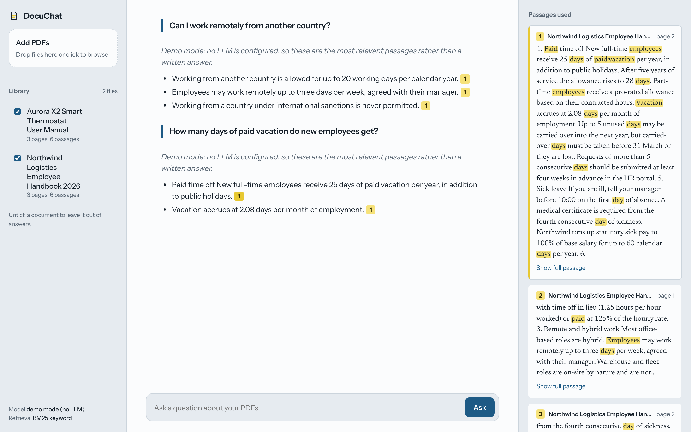

# DocuChat: chat with your PDFs (RAG)

[](https://github.com/hamidomail/docuchat-rag-pdf/actions/workflows/tests.yml)

A production-minded **retrieval-augmented generation (RAG)** chatbot. Upload PDFs, ask questions in plain language, and get answers written **only from your documents**, with every claim linked to the exact page it came from.



## What it does

- **Upload PDFs** by drag and drop. Text is extracted page by page, running headers and footers are removed, and pages are split into overlapping passages.
- **Hybrid retrieval**: BM25 keyword search, optionally fused with semantic embeddings (Reciprocal Rank Fusion). Works with zero API keys; add embeddings for better recall on paraphrased questions.
- **Grounded answers with citations**: the model must cite passages as `[1]`, `[2]`. Clicking a citation opens the passage with the matching words highlighted.
- **Any LLM**: Anthropic Claude, OpenAI, or any OpenAI-compatible API (Groq, Mistral, OpenRouter, Azure gateways, **Ollama / LM Studio for fully local and private use**).
- **Streaming** responses over Server-Sent Events.
- **Follow-up questions** keep conversation context ("and for part-time staff?").
- **Scope** answers to selected documents; duplicate uploads are detected.
- **Demo mode**: with no LLM configured, it returns the most relevant passages (extractive), so the app always runs.
- **Retrieval evaluation** script with hit@k and MRR, to tune chunking and retrieval on real data.

## Architecture

```
PDF ──► pypdf extraction ──► header/footer removal ──► page-bounded chunking (900 chars, 150 overlap)
                                                                 │
                                       ┌─────────────────────────┴─────────────────────────┐
                                       ▼                                                   ▼
                                  BM25 index                               Embeddings (optional, OpenAI-compatible
                                       │                                   or sentence-transformers)
                                       └──────────► Reciprocal Rank Fusion ◄───────────────┘
                                                            │ top-k passages
Question ─► follow-up rewrite ─► retrieve ─► grounded prompt (numbered excerpts) ─► LLM (stream) ─► answer + citations
```

| Layer | Choice | Why |
|---|---|---|
| API | FastAPI, SSE streaming | Small, typed, easy to deploy |
| Parsing | pypdf | Pure Python, no system dependencies |
| Index | NumPy + JSON on disk | No vector DB to run for small/medium corpora; swap for Qdrant/pgvector at scale |
| LLM | Plain HTTP (httpx) | No SDK lock-in; one code path for all OpenAI-compatible providers |
| UI | Vanilla HTML/CSS/JS | Zero build step; responsive, dark mode |

## Quick start

```bash
python -m venv .venv && source .venv/bin/activate     # Windows: .venv\Scripts\activate
pip install -r requirements.txt
cp .env.example .env              # optional: add an API key (see below)
uvicorn app.main:create_app --factory --port 8000
```

Open http://localhost:8000 and drop the PDFs from `sample_docs/` (a fictional employee handbook and a thermostat manual).

**With Docker:** `docker compose up --build`

### Choosing a model (`.env`)

```bash
# Claude
ANTHROPIC_API_KEY=sk-ant-...
# or OpenAI
OPENAI_API_KEY=sk-...
OPENAI_MODEL=gpt-4.1-mini
# or a free local model with Ollama (nothing leaves your machine)
OPENAI_BASE_URL=http://localhost:11434/v1
OPENAI_MODEL=llama3.1
# semantic search (optional)
EMBEDDINGS_PROVIDER=openai          # uses OPENAI_BASE_URL; with Ollama set EMBEDDINGS_MODEL=nomic-embed-text
```

## API

| Method | Path | Description |
|---|---|---|
| `POST` | `/api/documents` | Upload a PDF (multipart `file`) |
| `GET` | `/api/documents` | List indexed documents |
| `DELETE` | `/api/documents/{id}` | Remove a document and its passages |
| `POST` | `/api/chat` | `{question, history?, doc_ids?}`, streams `sources`, `token`, `done` events |
| `POST` | `/api/search` | Retrieval only, returns ranked passages |
| `GET` | `/api/health` | Provider, model and index stats |

Interactive docs at http://localhost:8000/docs.

## Quality

```bash
pip install -r requirements-dev.txt
pytest -q                          # 17 tests: chunking, retrieval, persistence, API end to end
python scripts/eval_retrieval.py   # retrieval benchmark on 20 labelled questions
```

Baseline with keyword retrieval only (no API key), 20 paraphrased questions:

| Retrieval | hit@1 | hit@3 | MRR |
|---|---|---|---|
| BM25 | 85% | 95% | 0.91 |

Re-run with `EMBEDDINGS_PROVIDER` set to compare hybrid retrieval on your own documents.

## Taking it to production

- Scanned PDFs: add OCR (Tesseract, AWS Textract or Azure Document Intelligence) before chunking.
- Large corpora: replace the NumPy index with Qdrant, pgvector or OpenSearch; the `DocumentStore` interface stays the same.
- Multi-user: add auth (OAuth/JWT) and per-tenant indexes.
- Add a re-ranker (Cohere Rerank or a cross-encoder) for long, dense documents.

## Project layout

```
app/        config, PDF ingestion, index & retrieval, LLM clients, RAG pipeline, FastAPI app
static/     web UI
scripts/    sample PDF generator, retrieval evaluation
eval/       labelled questions
tests/      pytest suite
```

The sample documents are fictional and generated by `scripts/make_sample_pdfs.py`.
